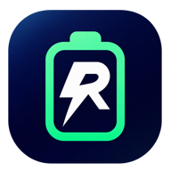
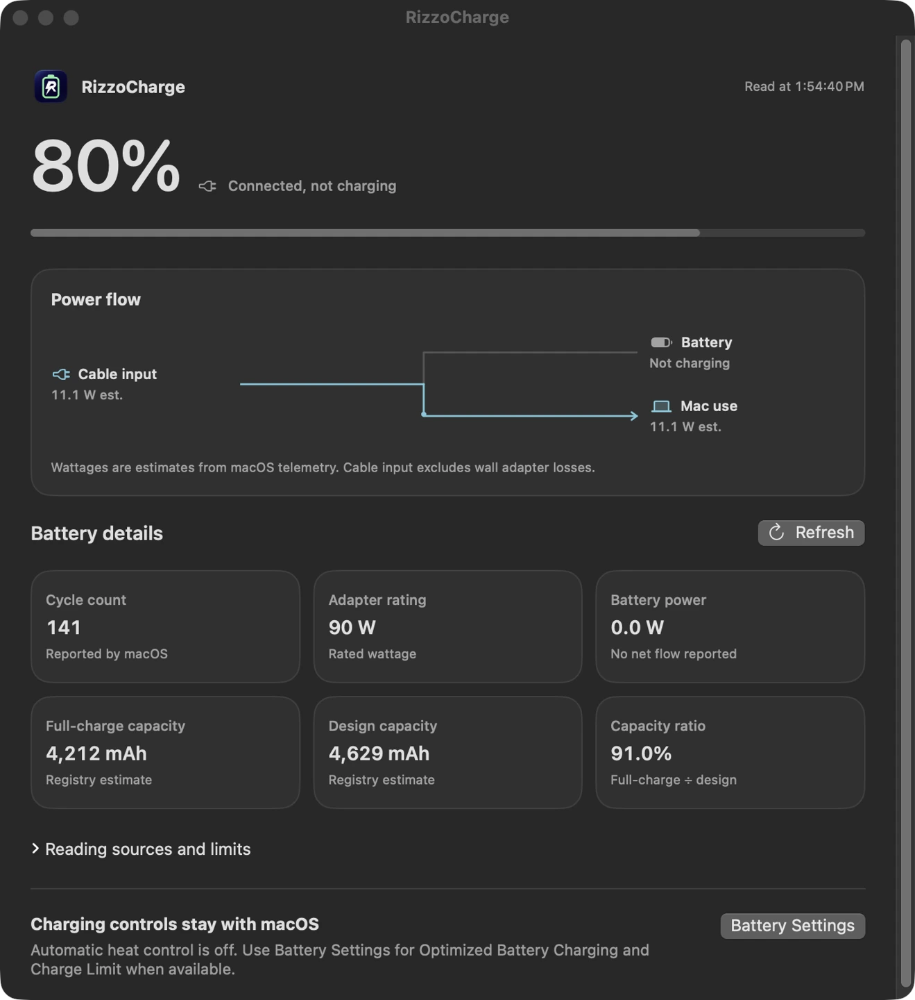

<h1 align="center">RizzoCharge</h1>

Battery status, estimated power flow, and battery details for your Mac.

<a href="https://johnrizzetto.github.io/RizzoCharge/">Project site</a> · <a href="https://github.com/johnrizzetto/RizzoCharge/releases/latest">Download</a> · <a href="#build-locally">Build locally</a>

RizzoCharge lives in the menu bar. Open the dashboard for cycle count, pack power, and capacity. If a menu-bar manager hides the icon, reveal its hidden items or reopen RizzoCharge from Finder. Press Command-R in the dashboard to refresh.

## Install

Download the ZIP from [Releases](https://github.com/johnrizzetto/RizzoCharge/releases/latest), extract it, and move RizzoCharge.app into Applications. The app is ad-hoc signed and has no Apple notarization. Each release includes a SHA-256 checksum.

## Readings

The app polls every five seconds and refreshes on IOKit power-source changes and wake. It hides a snapshot after 15 seconds or when notified that the Mac is going to sleep. "Read at" is the time the app read the snapshot. Firmware values may update more slowly, and individual values do not provide reliable sensor timestamps.

| Reading | Source | Interpretation |
| --- | --- | --- |
| Charge and power state | Documented IOKit power-source description, internal battery only | Percent from current/max and states from power source plus charging flag. Unknown or contradictory flags do not imply battery power. |
| Cycle count | AppleSmartBattery CycleCount | OS registry count; matched System Information locally. |
| Adapter rating | Documented IOPSCopyExternalPowerAdapterDetails Watts | Attached adapter rating in W; matched System Information. This is not real-time input or wall draw. |
| Battery power | AppleSmartBattery Voltage and signed InstantAmperage | Pack estimate assuming mV and mA. Magnitude and direction are provisional. A value incompatible with the OS state is suppressed. Zero appears only if readings explicitly yield zero. |
| Full-charge and design capacity | AppleSmartBattery BatteryData FullChargeCapacity and DesignCapacity | Registry mAh estimates; corroborated by coconutBattery on Mac16,12. Ratio is a calculation, separate from Apple's health metric. |
| Apple battery health | System Information or Battery Settings | The documented IOKit description did not expose this value on the test Mac. View it in macOS. |
| Temperature | AppleSmartBatteryPack BatteryData Temperature | Undocumented raw candidate, excluded from the interface and all decisions. |
| Cable input and Mac use | AppleSmartBattery PowerTelemetryData SystemPowerIn and SystemLoad | Undocumented Mac-side estimates in W, enabled while on AC on Mac16,12 with macOS 27. RizzoCharge checks input voltage × current and input minus pack power against the reported load. Missing or inconsistent values stay unavailable. These checks do not independently verify accuracy or sensor freshness, and cable input is not wall draw. |

A read-only diagnostic snapshot is available at `dist/RizzoCharge.app/Contents/MacOS/RizzoCharge --snapshot`. It includes provisional registry data for comparison, including raw temperature and load/input fields; absent values are omitted. It performs no writes, requires no helper and collects no serial numbers.

## Charging controls

RizzoCharge does not change charging settings or send alerts from the unverified sensor. Apple documents 35°C as an upper ambient operating temperature, not a pack threshold. Its native Charge Limit and Optimized Battery Charging are available in Battery Settings on the verified Mac. Native limits are based on charge percentage and macOS may occasionally charge to full for calibration. No reliable thermal pause and restoration mechanism was established for this hardware.

## Build locally

Run `./build-mac.sh` on macOS with Xcode or Command Line Tools. It runs the Swift tests, builds and ad-hoc signs the bundle, and writes the app, ZIP and checksum to `dist/`. The bundle is not notarized. No macOS security setting needs to change.

Verified on an Apple silicon MacBook Air (Mac16,12), macOS 27.2.1 build 26B131. The current deployment target is macOS 13; compatibility was not verified on older releases.

## References

- [Apple IOKit power sources](https://developer.apple.com/documentation/iokit/iopowersources_h) and [adapter ratings](https://support.apple.com/en-us/109509)
- [Managing Mac charging](https://support.apple.com/en-us/102338) and [ambient operating temperatures](https://support.apple.com/en-us/102336)
- [Apple macOS design guidance](https://developer.apple.com/design/human-interface-guidelines/designing-for-macos), [motion](https://developer.apple.com/design/human-interface-guidelines/motion) and [accessibility](https://developer.apple.com/design/human-interface-guidelines/accessibility)
- [coconutBattery](https://www.coconut-flavour.com/coconutbattery/), [AlDente power flow](https://apphousekitchen.com/aldente-overview/features/#power-flow), [BatteryBoi](https://github.com/thebarbican19/BatteryBoi/releases/latest) and [iStat Menus power](https://bjango.com/help/istatmenus7/power/)
